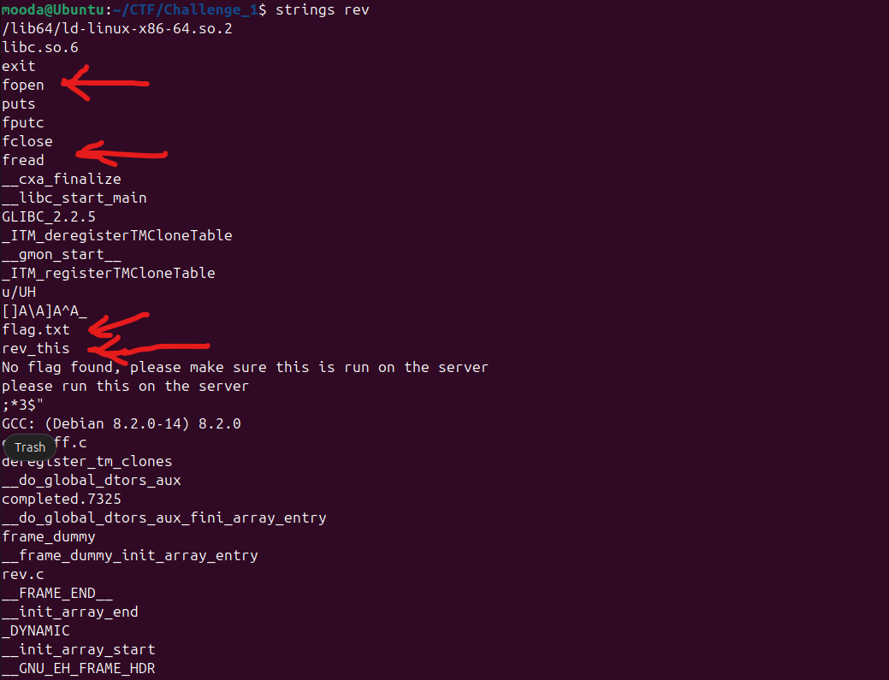

<Intro>
## Introduction

In this writeup, I kick off my **100 Reverse Engineering Challenges Challenge**. I will provide a detailed step-by-step explanation with full transparency, as I promised.

The binary in this challenge, named reverse_cipher, reads the flag file, performs some operations on it, and eventually writes the result to the file provided by the challenge. So I had to take the file provided by the challenge and reverse my way to the flag.

</Intro>

<!-- truncate -->

## Problem Statement

In this challenge, we are provided with two files: one is the binary to reverse, and the other is a text file that we need to perform some operations on to extract the flag. The problem statement reads as follows:

> We have recovered a binary and a text file. Can you reverse the flag.

## Hints

Below is the hint provided by the challenge, which, by the way, I did not use:

> objdump and Gihdra are some tools that could assist with this.

## My Solution

We always start with some quick analysis, so I ran strings on the file `rev`. As we can see from the screenshot below, there are some references to standard C functions, such as `open` and `close`, and two filenames, `flag.txt` and `rev_this`:



Given the above clues from `strings`, we can infer that the flag file is being read and is somehow related to the `rev_this` file, and we need to investigate this further. So we have to go to Ghidra or another reverse engineering tool to see what is going on by examining the decompiled code.

When we open the binary in Ghidra, we get the following code:

```C
void main(void)
{
    size_t sVar1;
    char local_58 [23];
    char local_41;
    int local_2c;
    FILE *local_28;
    FILE *local_20;
    uint local_14;
    int local_10;
    char local_9;

    local_20 = fopen("flag.txt","r");
    local_28 = fopen("rev_this","a");
    
    if (local_20 == (FILE *)0x0) {
        puts("No flag found, please make sure this is run on the server");
    }
    
    if (local_28 == (FILE *)0x0) {
        puts("please run this on the server");
    }

    sVar1 = fread(local_58,0x18,1,local_20);
    local_2c = (int)sVar1;
    if ((int)sVar1 < 1) {
                    /* WARNING: Subroutine does not return */
    exit(0);
    }

    for (local_10 = 0; local_10 < 8; local_10 = local_10 + 1) {
        local_9 = local_58[local_10];
        fputc((int)local_9,local_28);
    }

    for (local_14 = 8; (int)local_14 < 0x17; local_14 = local_14 + 1) {
        if ((local_14 & 1) == 0) {
            local_9 = local_58[(int)local_14] + '\x05';
        }

        else {
            local_9 = local_58[(int)local_14] + -2;
        }
        fputc((int)local_9,local_28);
    }

    local_9 = local_41;
    fputc((int)local_41,local_28);
    fclose(local_28);
    fclose(local_20);

    return;
}
```

After changing some variable names, I got a clearer idea of what the code is doing:

```C
void main(void)
{
    size_t sVar1;
    char flag [23];
    char local_41;
    int local_2c;
    FILE *given_file;
    FILE *flag_file;
    uint i;
    int i;
    char local_9;

    flag_file = fopen("flag.txt","r");
    given_file = fopen("rev_this","a");
    
    if (flag_file == (FILE *)0x0) {
        puts("No flag found, please make sure this is run on the server");
    }
    
    if (given_file == (FILE *)0x0) {
        puts("please run this on the server");
    }

    sVar1 = fread(flag,0x18,1,flag_file);
    local_2c = (int)sVar1;
    if ((int)sVar1 < 1) {
                    /* WARNING: Subroutine does not return */
    exit(0);
    }

    for (i = 0; i < 8; i = i + 1) {
        local_9 = flag[i];
        fputc((int)local_9,given_file);
    }

    for (i = 8; (int)i < 0x17; i = i + 1) {
        if ((i & 1) == 0) {
            local_9 = flag[(int)i] + '\x05';
        }

        else {
            local_9 = flag[(int)i] + -2;
        }
        fputc((int)local_9,given_file);
    }

    local_9 = local_41;
    fputc((int)local_41,given_file);
    fclose(given_file);
    fclose(flag_file);

    return;
}

````

So, from the code above, we can see that two files are being opened: the flag file (`flag.txt`) and the file provided by the challenge (`rev_this`). Then, at the line `sVar1 = fread(flag,0x18,1,flag_file);`, 24 bytes are read from the flag file into a buffer (`flag`).

Then, we have two `for` loops, both of which write information to the provided file (`given_file`). The former writes the characters at indices `0` through `7` without performing any transformations on them, using `fputc()`, while the latter writes the characters at indices `8` through `22` (`0x16` in hexadecimal) after performing some transformations on them.

But what I noticed here is that `fread()` requests `0x18` bytes, while the two loops together process only `0x17` bytes. So I guess the line `fputc((int)local_41,given_file);` is related to writing the last character, which I suspect is `}`.

The transformations inside the second loop are as follows: if the index ANDed with `1` results in `0`, add `0x05` to the character at that index. Otherwise, subtract `2` from that character. The weird syntax of adding a negative number is Ghidra's awkward way of representing subtraction.

So it is only a matter of writing a small Python script to perform exactly the above steps, but in reverse. Instead of adding `0x05`, we subtract it, and instead of subtracting `2`, we add `2`.

So I wrote the following script:

<Snippet
  filename="script.py"
  source="./files/script.py"
  defaultOpen={true}
/>

As I mentioned before, I only needed to reverse the operations to grab the flag. But while doing that, I needed to pay attention to something: I used `read()`, which returns a string object. So, to perform mathematical operations on the flag characters, I needed to get their integer values, do the magic on these values, and then convert them back to their corresponding characters.

To do that, I used Python's `ord()` function to get the integer values, performed the mathematical operations on them, and then converted them back to their corresponding characters using the `chr()` function.

After running the script, I successfully got the flag.

## Flag

The recovered flag is: `academy{r3v3rs354680934}`

## Alternative Solution

To benefit from others' ways of thinking and approaches, I read [this official writeup](https://github.com/Dvd848/CTFs/blob/master/2019_picoCTF/reverse_cipher.md)

<Snippet
  filename="writeup_script.py"
  source="./files/writeup_script.py"
  defaultOpen={true}
/>

As we can see from the writeups' script above, it uses the `os` module to access the filesystem and its `path` submodule to manipulate filesystem paths. It also uses `mmap` to map the file into memory, allowing its contents to be accessed as if they were in memory.

The main difference between my approach and the approach used in this writeup is the use of `mmap`. When accessing individual bytes through an `mmap` object, Python returns their integer values directly. Therefore, there is no need to use `ord()` to convert characters into integers. We can directly manipulate these integer values, perform mathematical operations on them, and then use `chr()` to convert the results back into their corresponding characters.

## Lessons Learned and Key Takeaways.

This challenge merely involved applying simple transformations to the flag file. As far as I am concerned, it is not even a medium-level challenge; it should be placed in the Simple category.

While solving it, I brushed up on some old knowledge. For example, I looked up the signature of `fputc()` in C. I also revisited the usage of `chr()` and `ord()` in Python. From another writeup I read, I was also reminded that there is a module called `os.path` for manipulating filesystem paths.

Eventually, I learned that there is a module called `mmap` that allows us to map a file into the virtual address space of a process and work with it as if it were memory. I guess that was my win for this challenge.

I am looking forward to the next one!